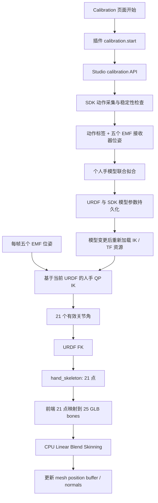

# Wuji Studio calibration → 人手 IK → mesh：发行包复原

调查日期：2026-11-12。主要目标是本机 **Wuji Studio 2026.7.1**；对照 **wuji-sdk 2026.7.1**，新版 2026.11.9 只作版本比较。

结论：标定阶段根据若干已知动作下的五个 EMF 接收器位姿，估计个人手模型及传感器外参，写成 URDF。后续每帧使用该 URDF 求人手 IK，再用 FK 输出 21 个骨骼点。Studio 把这些点映射到固定 GLB 的 25 个骨骼，执行 CPU 线性蒙皮，形成看到的 mesh。

这解释了“标定后 mesh 和骨骼一起变化”：长期变化的上游状态是手模型参数；前端通过新的骨骼位置得到不同的 mesh。恢复出的前端路径没有 MANO beta、顶点形状优化或迭代 IK。

## 直接查看与运行

- [离线交互演示](../output/reports/wuji_studio_rea_20261112/mesh/demo.html)：模板、21 点骨架、蒙皮结果三个同步视图；不依赖网络，演示动作为合成数据。
- [mesh 精确复原与验证](../output/reports/wuji_studio_rea_20261112/mesh/README.md)：提取出的原始函数、真实 GLB、可复用实现和逐顶点对照。
- [SDK 离线验证脚本](../output/reports/wuji_studio_rea_20261112/sdk/probe_offline_2026_7_1.py)、[验证数据](../output/reports/wuji_studio_rea_20261112/sdk/offline_probe_2026.7.1.json)：用同版 SDK 的原生求解器检查 URDF、关节角和骨骼点关系。
- [SDK 原生证据笔记](../output/reports/wuji_studio_rea_20261112/sdk/NOTES.zh-CN.md)：动作表和筛选调用链、61 维字段、版本对照。
- [SDK 输出重建的 OBJ](../output/reports/wuji_studio_rea_20261112/mesh/sdk_offline_mesh.obj)：合成 EMF → 原生 SDK IK → 21 点 → 复原蒙皮的完整离线链。

```bash
# 已安装的 REA
/home/zz/.local/bin/rea --version

# 重跑 mesh 与原始发行函数的对照
cd /home/zz/retarget/output/reports/wuji_studio_rea_20261112/mesh
node validate.mjs

# 用自己的 SDK 21 点导出 mesh，JSON 每项有 pose.position
node run_reconstruction.mjs right sdk_offline_joints.json output.obj

# 同版官方 SDK 的无设备离线探针（使用独立解包的 cp312 wheel）
/usr/bin/python3 /home/zz/retarget/output/reports/wuji_studio_rea_20261112/sdk/probe_offline_2026_7_1.py
```

## 证据来源与版本

| 对象 | 身份 | 本次用途 |
|---|---|---|
| REA npm | 6.9.0，独立 Node 24.22.3 | 插件和 mesh 静态分析、原生分析 |
| REA Git | `d74549e495c58eb4a560279fd9f05508401ea0a0` | 安装与分析工具文档 |
| wuji-sdk Git | `92aa2d07031575649c0e2ad12da3f36c219b8fe3` | 公开 API 示例；不等于 Studio 内嵌源码 |
| 本机 Studio | `/usr/bin/wuji-studio`，2026.7.1 | 实际插件、渲染函数、GLB、内嵌手模型 |
| Studio ELF SHA256 | `dcabb009f021d0a705d6a2c9fb5bacc9ea7143956c3d76c92849f76362db38d6` | 固定分析目标 |
| 内嵌原生依赖 | `wuji_caliber` commit `e8ac32e681af282fa229650de42c2f6c79ec9c3e` | 手模型标定与 IK |
| 同版 Python SDK | 2026.7.1；独立下载、解包，未替换项目环境 | 原生离线实验；同一 caliber commit |

公开 [wuji-sdk](https://github.com/wuji-technology/wuji-sdk) 主要是示例与发布产物，[wuji-studio](https://github.com/wuji-technology/wuji-studio) 当前公开仓库主要是 README/CHANGELOG。核心 caliber 源码没有在这两个公开仓库中给出。因此本调查结合了公开 API、安装目录中的 JS、ELF 内嵌资源、原生静态分析和同版 SDK 的离线实验。

新版资料有明确边界：Studio 2026.7.14 后调整了按用户和左右手的模型存储；2026.11.9 还调整了联合求解性能。新版的动作阈值和文件路径不能直接当成本机 2026.7.1 的实现。

## 调用链



这里的人手 IK 和机械手 retarget 是不同阶段。本报告覆盖人手模型、`hand_joint_angles`、`hand_skeleton` 与前端 mesh；没有把 Wuji Hand2 的 20 维机器人角度当成人手角度。

## Calibration 插件做什么

实际文件：`/usr/lib/wuji-studio/system-extensions/wuji.calibration/dist/extension.js`，全局注入的 `__wujistudioApi.calibration` 在 bundle 中别名为 `h`。

开始调用是 `h.start(deviceId)`，不传 hand profile override。插件同时订阅 `emf_poses` 统计健康计数，并录制 `emf_poses`、`tf`、`tf_static`、`hand_joint_angles`、`hand_skeleton`、`tip_poses`、IMU 等调试 topic。它只负责 UI 状态和调试记录，不在 JS 中拼装姿态约束或运行优化器。

`onProgress`、`onResult` 通过 webview 消息转发；start/cancel 按设备串行，使用 sessionId 避免把取消或过期结果算成新任务完成。`storage.user.local` 的 `calibration:record:*` 是 UI 历史，真正是否有模型由 `calibration.hasProfile` 查询 SDK。

这有两份相互对应的发行证据：插件自己的 README 明确说明职责，JS 的实际 API 调用也与它一致。

REA 完整插件证据：[rea_calibration_bundle.json](../output/reports/wuji_studio_rea_20261112/evidence/rea_calibration_bundle.json)，父 Evidence `ev_ee93766b8a42cb245553988cc42e3e4d6155bb87557918c6843e2cf495715f94`。只选择了插件入口文件，不能用它推断原生实现或未选文件不存在。

## 采集的不是相机 21 点

标定的输入是每个 EMF 接收器相对发射器的 6DoF 位姿，五指顺序为 thumb/index/middle/ring/pinky。一个动作对应稳定的一段观测和已知动作语义。

SDK 的反馈字段包含 `waiting_movement`、`waiting_stability`、`collecting`、`done` 以及 `hold_elapsed`、`hold_target`、`variance_ok`、`constraints_ok`、`collect_elapsed`、`collect_target` 等。含义是先检测动作变化，再检查稳定性和该动作约束，持续满足后采样；这些条件为后面的模型拟合提供较可信的数据。

旧二进制中有八项 SDK 动作定义：`thumb_to_index_dip`、`index_to_thumb_emf`、四种 pinch、`four_finger_bend_90`、`flat_open`；还有六项 caliber 名称映射表。进一步检查原生调用者及迭代器，确认先根据六项表构造名字集合，再按八项 SDK 表的原顺序筛选，所以实际默认顺序是：

```text
pinch_index → pinch_middle → pinch_ring → pinch_pinky
→ four_finger_bend_90 → flat_open
```

八张 guide 图不等于默认八步。静态证据见 [pose_selection.asm](../output/reports/wuji_studio_rea_20261112/sdk/2026.7.1_pose_selection.asm)、[pose_filter.asm](../output/reports/wuji_studio_rea_20261112/sdk/2026.7.1_pose_filter.asm)；地址均为 ELF 原链接地址，Ghidra 导入该 SO 后需加 `0x100000`。

从**旧版**约束数据表还可直接解出下列值；这是数据布局和筛选调用链证据，尚不代替约束枚举评估函数的完整反编译：

| 动作 | 数据中的约束 |
|---|---|
| 四种 pinch | 一个约束；thumb 与目标指；浮点距离阈值 0.05 m |
| 四指 90° | roll `[-135,-45]`、pitch `[-38,50]`、yaw `[-35,40]` 度 |
| 平掌 | roll `[-40,35]`、pitch `[-30,40]`、yaw `[-30,50]` 度 |

旧版的采集常数已经从调用者指令、浮点常量及反馈字段交叉恢复：hold 1 秒、collect 1 秒、反馈间隔约 0.3 秒、每动作超时 120 秒；采集中不稳定会清空当前采集并重新等待稳定。没有进行真人戴手套的标定采集。

稳定性只使用五个 RX 的 xyz，不使用旋转。维护最近 20 帧，未满窗口返回“不稳定”；满后计算每个指头、每个轴的位置时间方差，再取 15 个方差中的最大值：

```text
mu[f,a] = mean_t p[t,f,a]
V[f,a] = mean_t (p[t,f,a] - mu[f,a])²
variance = max_f,a V[f,a]
variance_ok = variance <= 0.0002 m²
```

动作变化检测使用 `variance > 0.00002 m²`。这些是位置方差阈值，不能按数值直接解读成毫米位移阈值。代码证据、状态重置和确切指令位置见 [collector_optimizer_followup.md](../output/reports/wuji_studio_rea_20261112/sdk/collector_optimizer_followup.md)。

## 个人手模型的 61 维参数

发行包内的原生报告模板明确写出 `HandModel::to_vec()` 布局：全局 EMF TX 六维，加五指各十一维。报告字段生成循环的反汇编进一步支持具体顺序。

```text
H = [emf_tx_pos.x, .y, .z,
     emf_tx_rpy.roll, .pitch, .yaw,
     finger_thumb[11], finger_index[11], finger_middle[11],
     finger_ring[11], finger_pinky[11]]

finger[11] = [meta_pos.x, meta_pos.z,
              bones.proximal, bones.middle, bones.distal,
              emf_rx_pos.x, emf_rx_pos.y, emf_rx_pos.z,
              emf_rx_rpy.roll, emf_rx_rpy.pitch, emf_rx_rpy.yaw]
```

位置、骨长使用 mm，旋转使用 rad。注意这里不是每指完整 6DoF 掌骨位姿都自由优化：布局中的掌骨平移只取 x/z；也不能把初始化 JSON 中的所有字段都算成独立决策变量。

这个模型包含三类内容：手指根部位置、三段骨长、传感器相对末端骨骼的安装外参；全局还有 TX 相对手模型的位置与方向。不过**模型里存在某参数不代表本次优化放开它**：主拟合通过 projection 固定了五指的 `meta_pos.x/z`，即下标 `[6,7,17,18,28,29,39,40,50,51]`。自由的手模型参数为 TX 6 维 + 五指各 9 维 = **51 维**。

因此不能说它在主 L-BFGS 阶段自由调整了全部掌骨根位置。当前静态调用链显示先选择 profile 的内置 skeleton JSON 构造初始模型，再固定这些 meta 分量；尚无证据表明它在此前用 flat 动作重新估计了这些分量。只拟合指尖轨迹、不估计传感器偏置，也无法完整表达这套标定。

## 多动作如何约束这些参数

以下是根据原生报告、字段和模块边界恢复出的**数学结构**；它不冒充逐语句原 Rust 源码。令 `H` 为共享手模型，`q_s` 为动作 s 的人手关节角，`Z_sf` 为该动作第 f 个接收器观测：

```text
预测接收器位姿 = inverse(T_wrist_TX(H))
                   * FK_wrist_finger(H, q_s)
                   * T_finger_RX(H)

总 cost = Σ_s Σ_f [||位置残差||² / sigma_emf_pos²
                    + ||旋转残差||² / sigma_emf_rot²]
           + 每个动作的语义约束
           + 跨动作共享的手型/外参先验
```

拟合前先把每种动作的采样帧压成一个五指平均观测：位置由米乘 1000 转毫米后求均值；四元数由 `Σ q qᵀ` 的最大特征值对应向量取得平均方向。它不是把每个采样帧都当成一套自由姿态，也不是逐分量平均四元数。

共享 H 而每个动作有自己的 21 维姿态，这让多个姿势共同约束骨长和安装外参，减少仅凭一个姿势的歧义。正常六动作时，完整向量为 `61 + 6×21 = 187`，固定十个 meta 分量后，NLopt 的自由变量数为 **177**。具体观测聚合、vector append 和 projection 指令见 [fit_notes.md](../output/reports/wuji_studio_rea_20261112/native/fit_notes.md)。

| 原生报告中的 cost | 作用 |
|---|---|
| FK pos / rot | 预测的五个 RX 位姿匹配 EMF 观测 |
| flat / palmFlat coplanar | 平手时指尖接近 XZ 平面 |
| flat orientation | 平手时 tip Z 方向接近目标方向 |
| theta_ref | 平手参考角接近零 |
| pinch_contact | 拇指与指定手指接触点距离约束 |
| tabletop_theta | 四指参考角接近 `[+90°,0,0,0]` |
| hyperextension | 限制屈伸关节反弓 |
| skeleton_ratio / bone_ratio | 手骨比例先验；报告默认 20 维，legacy meta ratio 可扩到 30 维 |
| emf_rx_range | 四指 RX 安装位置和角度先验 |
| emf_base_ratio / abs / wrist | TX 与 MCP、wrist 的距离和比例先验 |
| emf_tx_rpy / x / pitch | 全局 TX 朝向、侧向平移等先验 |

报告模板明确以 `(residual / sigma)^2` 计权。进一步追踪实例创建、GOT 槽和 setter，确认联合拟合使用 vendored NLopt 2.9.1 的 **LD_LBFGS**，设置 `ftol_rel=1e-10`、`maxeval=20000`、上下界和 objective callback。创建参数 `10` 与 [官方 v2.9.1 枚举](https://github.com/stevengj/nlopt/blob/v2.9.1/src/api/nlopt.h) 对应；容差 setter 的结构偏移也与该版本上游源码核对。

61 是共享手模型的参数数目，177 才是正常六动作下这次主 L-BFGS 的自由变量数。所有先验数值、边界默认值及梯度实现仍需进一步逐项核对。

## 模型如何影响后续人手 IK

旧 Studio 原生字符串中有 `SdkParamStore updated; online IK resources will reload automatically`；`hand_joint_angles`、`tf_static` 都有模型重新加载消息。标定写入的 URDF 因此成为后续求解和坐标变换的几何来源。

人手有效自由度为 `thumb 5 + 四指各 4 = 21`。SDK 的角度消息为每指五个槽位，四指最后一个槽为 0；这并不代表 25 个有效自由度。骨骼点也恰好有 21 个，但角度数和点数是不同概念。

原生 `QpIkConfig` 有 `dt`、`v_max`、`lm_damping`、`global_damping`、`rest_pose_weight`、`rest_pose_weight_thumb_scale`、`temporal_smooth_weight`、`config_limit_gain`。进一步对配置校验和步进函数做静态反汇编，恢复了以下代数；详细指令地址在 [qp_notes.md](../output/reports/wuji_studio_rea_20261112/native/qp_notes.md)。

定义程序已经加权的 6×n 任务矩阵为 A，反馈目标为 b，则每指求角度增量 delta：

```text
mu = lm_damping * dot(b,b) + global_damping
H = AᵀA + mu I
g = -Aᵀb
min_delta  0.5 deltaᵀH delta + gᵀdelta

lower = max(limit_gain * (q_min-q_iter), -passed_vmax*dt)
upper = min(limit_gain * (q_max-q_iter), +passed_vmax*dt)
q_iter += delta
```

rest 项在相应对角上加 r，在 g 上加 `r*(q_iter-q_rest)`；拇指有额外缩放，非拇指第 4 个自由度跳过该 rest 分支。temporal 项的梯度形如 `t*(q_iter-2*q_start+q_saved)`、对角加 t；历史推进语义尚未完全核对，不能直接把它称为固定物理时间的加速度约束。

外层先用配置速度上限做最多 40 轮；残差标量超过 0.005 时，从同一起点用 2 倍、4 倍速度各最多 36 轮尝试并择优。dt 进入增量界，`q+=delta` 时没有再乘一次 dt。

小型 box-QP 也已由独立范围反汇编恢复：使用 active-set + Cholesky，自零增量开始并夹到可行区；解自由变量子问题，越界变量钳到边界，再按梯度的 KKT 条件释放约束。最多 n+2 轮，Cholesky pivot 阈值 `1e-12`，释放条件容差 `1e-10`。这是发行代码自己的小维度求解器，不能直接替换成某通用 QP 库就宣称逐位等价。

位姿误差先构造 `R_currentᵀR_target` 与 `R_currentᵀ(p_target-p_current)`，支持 body-frame 相对变换的判断。SE(3) log 与 Jacobian 辅助函数的完整左右约定、历史状态推进和置信度公式仍未全部核对；报告保留实际装配后的 A、b 定义，不用未经确认的符号填补。

实际离线实验比字符串推测更强：

1. 从本机发行包提取 wrist-base URDF，用独立 Python FK 生成人造 EMF 位姿，连续输入同版 SDK 的 `WujiGlove.offline_pipeline` 80 帧。
2. SDK 返回 21 个骨骼点和 5 个 tip，坐标 frame 是 `r_wrist`。
3. 对 SDK 返回的 21 个有效角度独立做 URDF FK，逐点与 `hand_skeleton` 对照，最大误差 **6.54×10⁻⁹ m**。这验证了骨骼输出确实来自求解角度和 URDF FK。
4. 固定相同 EMF 观测，仅把 index proximal 长度乘 1.2：该指关节角改变，另四指结果完全不变；index confidence 从 **0.9883 降到 0.9066**。模型几何确实参与 IK，而非仅用于显示。
5. 相同观测的第一帧和第八十帧角度不同，符合有状态的迭代/时序求解；生成观测的角度与最终 IK 角度并非严格相等，不能把 SDK 当作无正则的精确逆 FK。

该实验执行的是同版 SDK 的原生离线接口，没有连设备、没有修改用户标定、没有证明实际在线调度和硬件时延。

## 21 点如何变成 mesh

这里已恢复全部实际前端函数并做数值对照，细节见 [mesh 报告](../output/reports/wuji_studio_rea_20261112/mesh/README.md)。

左右模板各有 **2187 顶点、4318 三角形、25 根平级 bones**。每帧：

1. SDK→GLB：左手 `(x,z,-y)`，右手 `(-x,z,y)`。
2. 20 个映射点直接赋给 bone.position；输入 thumb_cmc 不映射，五根 metacarpal 留在 bind position。
3. 用 bind/current 骨段方向差四元数更新 rotation；tip 复制 distal rotation。输入的 orientation 不参与这条 mesh 路径。
4. 计算 `S_i = inverse(meshWorld) * boneWorld_i * inverseBind_i`。
5. CPU 蒙皮 `v' = Σ_k weight_k * S_joint[k] * v_bind`，再变回 SDK 坐标，更新 position buffer、法线和包围球。

手骨长度改变后，SDK FK 的点间距改变，前端直接移动骨骼，LBS 就拉动各自权重关联的顶点。所有 bone.scale 始终为 1；它没有重新训练权重或重建拓扑。

左右各 40 个随机输入与发行包原始 `HandModelRenderer` 隔离执行对照，全部顶点、bone position、quaternion 的最大误差均为 **0**；LBS 与 Three 参考运算的误差为 **1.49×10⁻⁸**。这是提取函数级别验证，不是完整 Studio UI 或真人数据验证。

## 本次复原的边界

已完成并运行验证：原始 mesh 模块与真实模型提取、独立 mesh 实现、SDK IK→FK→骨架一致性、修改 URDF 后的求解变化、SDK 骨架到 OBJ 的完整离线链。

已经定位但仍需进一步逐项核实：联合标定全部权重/边界默认值与梯度实现、在线误差/Jacobian 的完整修正约定和置信度公式。本次没有用自拟的优化器宣称与原生标定逐位等价，也没有用新版文档补造旧版常数。

原始数据和 REA Evidence 保存在 [output/reports/wuji_studio_rea_20261112](../output/reports/wuji_studio_rea_20261112)。结果区中的裸字符串和普通工具反汇编，与 REA 生成的 Evidence 分开命名；两者均为静态证据，不自动代表运行中观测。

原生 REA/Ghidra 成功取得 `HandModel::to_vec` 的反编译 Evidence `ev_d723a01d79dc9281f9fdbf6e18593c174c806093be73d9999ad22846497e04cc`，见 [rea_native_bundle.json](../output/reports/wuji_studio_rea_20261112/native/focused/rea_native_bundle.json)。大拟合函数被 Ghidra 合并到超出 ELF unwind 已知边界的范围，未取得可靠伪码，因此已取消，并关闭/导出/重置分析会话。原生优化与 QP 的主要结论以明确地址范围的机器码、对应版本上游 NLopt 源码和 SDK 离线实验为依据；没有把取消的反编译当作成功结果。
